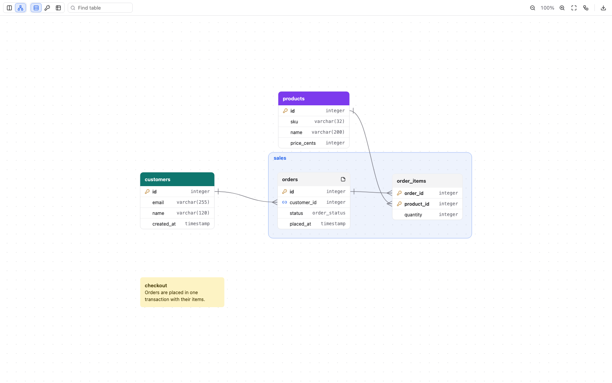

<p align="center">
  
</p>

<h1 align="center">DBML for Orca</h1>

<p align="center">
  Edit a <a href="https://dbml.dbdiagram.io/home">DBML</a> schema in <a href="https://github.com/stablyai/orca">Orca</a> and watch its ER diagram redraw as you type.
</p>



Coding agents write database schemas faster than anyone can read them, and a long list of `Table` blocks rarely shows how the tables connect. This plugin opens every `.dbml` file in Orca as code on the left and a diagram on the right, so you can see the structure at a glance and still edit the text. It uses `@dbml/parse`, which is the same compiler dbdiagram.io uses, so the errors and relationships you see match the official tools.

## Install

You can find **DBML** in the [Orca plugin directory](https://orca.dev/plugins/brian-rey-development/orca-dbml). If you prefer to install it straight from GitHub, open **Settings → Plugins** in Orca, choose **Add plugin → From a Git URL…** and paste this URL.

```
https://github.com/brian-rey-development/orca-dbml#v1.1.0
```

The plugin doesn't ask for any permissions, because it only reads and edits the `.dbml` file you have open.

## Features

- **Live diagram.** The diagram updates while you type, and when an agent rewrites the file, both panes update without moving your cursor.
- **DBML editor.** The code pane highlights the syntax, underlines errors and suggests keywords, types and table names as you type. Long lines wrap.
- **Survives typos.** When the syntax breaks, the last diagram that worked stays on screen and the errors are listed, so you can click one to jump to its line.
- **All of DBML.** It draws header colors, keys, table groups, sticky notes, enums and table partials, and it shows relationships in crow's foot notation.
- **Notes on hover.** Hovering a column shows its type, constraints and note, and tables that have a note show a small icon in their header.
- **Your layout.** Tables are arranged for you at first, but you can drag them anywhere and they stay where you put them. **Auto-arrange** starts over.
- **Big schemas.** When a schema gets crowded, you can show only key columns or only table names, and **Find table** jumps to a table by name.
- **Export.** You can save the diagram as a PNG or an SVG.
- **Example file.** **New DBML schema** in the + menu creates a small online store schema to start from.

<p align="center">
  
  
</p>

## Working in the diagram

| Action                  | How                                                       |
| ----------------------- | --------------------------------------------------------- |
| Pan                     | Drag the background, or scroll                            |
| Zoom                    | Pinch, Ctrl or Cmd + scroll, the toolbar, or `+` and `-`  |
| Fit the diagram to view | The toolbar, or `0`                                       |
| Highlight a table       | Hover it, or click it to keep it highlighted              |
| Jump to a table's DBML  | Double-click it, or select it and press Enter             |
| Move between tables     | Focus the diagram and use the arrow keys                  |
| Find a table            | Type in **Find table** and press Enter                    |
| Jump to a problem       | Open the problems list from the toolbar and click an item |
| Resize the split        | Drag the divider, or focus it and use the arrow keys      |
| Clear the highlight     | Click the background, or press Escape                     |

## Limits

- **One file at a time.** Orca doesn't give plugins access to the file system, so names brought in with DBML `use` imports show up as missing.
- **Export needs the desktop app.** Orca's browser version has no save dialog, so the export buttons only appear on desktop.
- **No SQL export.** The official SQL exporter weighs about 16 MB, which is too much to bundle. You can run [`@dbml/cli`](https://dbml.dbdiagram.io/cli) in a terminal instead, for example `dbml2sql schema.dbml --postgres`.

## Development

You need Node.js 22 or newer and pnpm. The editor is a Preact app that gets bundled into a single file, `editor/index.html`, and that file is committed because Orca installs plugins straight from Git without running a build.

| Command          | What it does                                                                              |
| ---------------- | ----------------------------------------------------------------------------------------- |
| `pnpm build`     | Builds `editor/index.html` and regenerates `THIRD_PARTY_NOTICES.md`                       |
| `pnpm preview`   | Builds a browser preview with a stand-in for Orca, at `.preview/index.html`               |
| `pnpm test`      | Runs the unit tests, including the TextMate grammar through Oniguruma                     |
| `pnpm typecheck` | Type-checks the sources and tests                                                         |
| `pnpm check`     | Runs all of the above and fails if the committed build is out of date                     |
| `pnpm validate`  | Runs `orca plugin validate .` (needs the Orca CLI)                                        |
| `pnpm test:orca` | Adds the sync tests in `test/orca`, run on Orca's own editor session (needs the Orca CLI) |

To try a change in Orca, run `orca plugin dev watch .` in this folder, and Orca will reload the editor after every `pnpm build`.

Only `src/host` talks to Orca, which is why the rest of the code also runs in the browser preview.

| Folder        | Responsibility                                                                    |
| ------------- | --------------------------------------------------------------------------------- |
| `src/text`    | Line and column locations, text diffs and the merge of concurrent edits           |
| `src/schema`  | Compiles DBML and maps the result to a small, typed schema model with diagnostics |
| `src/layout`  | Lays nodes out with dagre, keeps them in place and remembers where they were put  |
| `src/diagram` | Measures cards, turns a schema and positions into a scene, and draws it as SVG    |
| `src/code`    | The CodeMirror pane, its DBML tokenizer, completion and linting                   |
| `src/export`  | PNG and SVG export                                                                |
| `src/app`     | The Preact app that wires the pieces together, including its tooltips             |
| `src/host`    | The bridge to Orca's frame API, and safe local storage                            |
| `syntaxes`    | The TextMate grammar and language configuration for Orca's Source view            |

## Releasing

1. Bump `version` in `orca-plugin.json` and `package.json`.
2. Run `pnpm check`, commit and push.
3. Push a matching tag such as `v1.2.0`, and the Orca plugin directory will pick it up within the hour.

## License

MIT. The bundled packages keep their own licenses, which are listed in [THIRD_PARTY_NOTICES.md](THIRD_PARTY_NOTICES.md).
