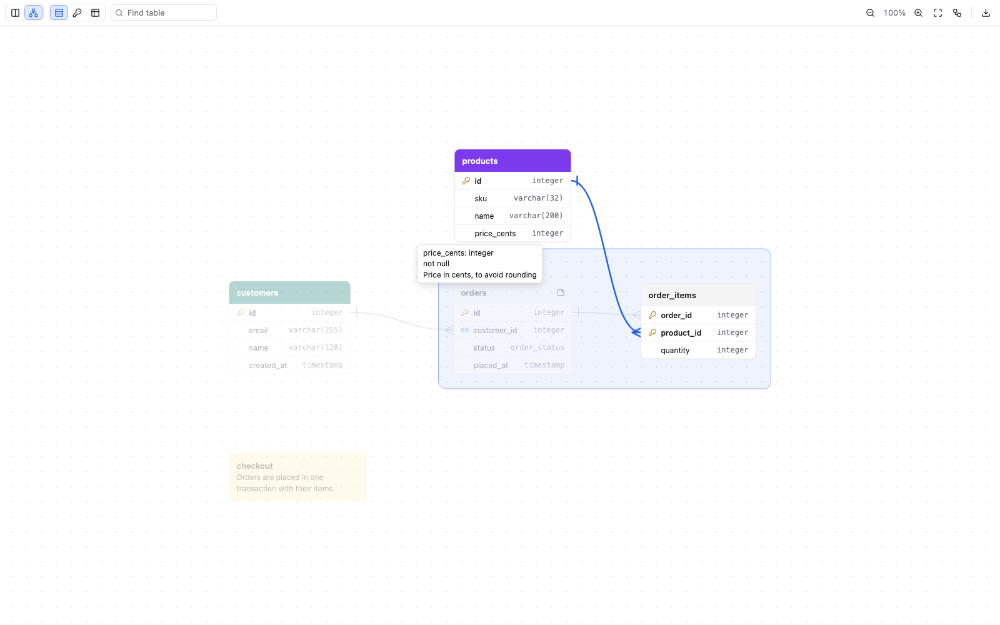
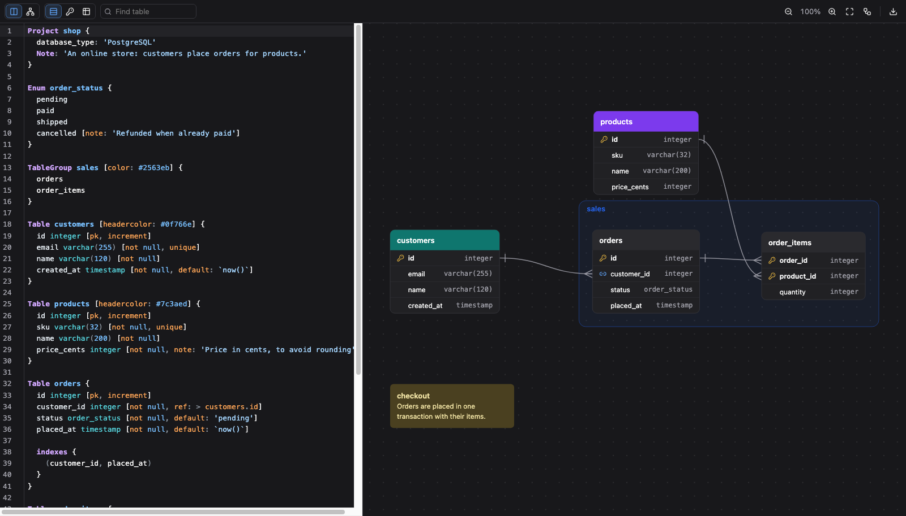

<p align="center">
  
</p>

<h1 align="center">DBML for Orca</h1>

<p align="center">
  Edit a <a href="https://dbml.dbdiagram.io/home">DBML</a> schema in <a href="https://github.com/stablyai/orca">Orca</a> and watch its ER diagram redraw as you type.
</p>


Agents write database schemas faster than anyone can read them, and a hundred lines of `Table` blocks say little about how the tables connect. This plugin opens every `.dbml` file as code beside a live diagram, so you can see a schema's shape at a glance and still edit the text. It parses with `@dbml/parse`, the compiler behind dbdiagram.io, so the errors it reports and the relationships it draws match what the official DBML tools see in the same file.

## Install

The plugin is listed in the community catalog of the [Orca plugin directory](https://orca.dev/plugins/brian-rey-development/orca-dbml). To install it straight from this repository instead, open **Settings → Plugins** in Orca, choose **Add plugin → From a Git URL…** and paste this URL.

```
https://github.com/brian-rey-development/orca-dbml#v1.1.0
```

The plugin asks for no capabilities. It never reaches the network, the file system or your terminals, and it only reads and edits the `.dbml` file it has open.

## Features

- **Split view.** The DBML source sits on the left and the diagram on the right. The diagram redraws 150 ms after you stop typing, and a file an agent rewrites updates in both panes without moving your cursor.
- **An editor that knows DBML.** It highlights the syntax, underlines the compiler's errors and warnings, and completes keywords, column types, settings, table names and the columns after `table.`. Long lines wrap. Orca's own Source view is highlighted too.
- **Diagrams that survive typos.** While the text does not compile, the diagram keeps the last valid version and a banner counts the problems, which open in a list that jumps to each line.
- **Everything DBML can describe.** Header colors, primary and foreign keys, relationships in crow's foot notation, table groups as tinted frames, sticky notes as cards, enums and table partials (`~name`).
- **Notes on hover.** Hovering a column shows its type, constraints, default, enum values and note. A table with a note has a note icon in its header, and hovering the header shows the note.
- **A layout you control.** Tables are arranged automatically, parents to the left of their children, and you can drag any of them. Positions are remembered per file, and a new table is placed beside your arrangement rather than reshuffling it. **Auto-arrange** starts over.
- **Large schemas stay readable.** The toolbar can reduce every table to its key columns or to its name, and **Find table** jumps to a table by name.
- **Export.** Save the diagram as PNG or SVG through Orca's save dialog.
- **A starting point.** **New DBML schema** in the + menu creates a file from a small online store example.

<p align="center">
  
  
</p>

## Working in the diagram

| Action                  | How                                                       |
| ----------------------- | --------------------------------------------------------- |
| Pan                     | Drag the background, or scroll                            |
| Zoom                    | Pinch, Ctrl or Cmd + scroll, the toolbar, or `+` and `-`  |
| Fit the diagram to view | The toolbar, or `0`                                       |
| Highlight a table       | Hover it, or click it to keep it highlighted              |
| Jump to a table's DBML  | Double-click it, or select it and press Enter             |
| Move between tables     | Focus the diagram and use the arrow keys                  |
| Find a table            | Type in **Find table** and press Enter                    |
| Jump to a problem       | Open the problems list from the toolbar and click an item |
| Resize the split        | Drag the divider, or focus it and use the arrow keys      |
| Clear the highlight     | Click the background, or press Escape                     |

## Limits

Orca gives a custom editor the open document but never its path or the file system, so the plugin sees one file at a time and DBML's multi-file `use` imports report the imported names as missing. Export appears only in Orca's desktop app, because the browser clients have no save dialog. SQL export is left out, since the official exporter loads every SQL grammar it supports, about 16 MB of code. For SQL, run the official [`@dbml/cli`](https://dbml.dbdiagram.io/cli) in an Orca terminal, for example `dbml2sql schema.dbml --postgres`.

## Development

The plugin needs Node.js 22 or newer and pnpm. The editor is a Preact app that esbuild bundles into the single file `editor/index.html`, because Orca's browser clients load a custom editor as one sandboxed document. That file is committed, since Orca installs plugins straight from Git without a build step.

| Command          | What it does                                                                              |
| ---------------- | ----------------------------------------------------------------------------------------- |
| `pnpm build`     | Builds `editor/index.html` and regenerates `THIRD_PARTY_NOTICES.md`                       |
| `pnpm preview`   | Builds a browser preview with a stand-in for Orca, at `.preview/index.html`               |
| `pnpm test`      | Runs the unit tests, including the TextMate grammar through Oniguruma                     |
| `pnpm typecheck` | Type-checks the sources and tests                                                         |
| `pnpm check`     | Runs all of the above and fails if the committed build is out of date                     |
| `pnpm validate`  | Runs `orca plugin validate .` (needs the Orca CLI)                                        |
| `pnpm test:orca` | Adds the sync tests in `test/orca`, run on Orca's own editor session (needs the Orca CLI) |

To try a change inside Orca, run `orca plugin dev watch .` in this folder. Orca reloads the editor each time `pnpm build` rewrites it.

Only `src/host` knows that Orca exists, and every other folder owns one part of the work.

| Folder        | Responsibility                                                                    |
| ------------- | --------------------------------------------------------------------------------- |
| `src/text`    | Line and column locations, text diffs and the merge of concurrent edits           |
| `src/schema`  | Compiles DBML and maps the result to a small, typed schema model with diagnostics |
| `src/layout`  | Lays nodes out with dagre, keeps them in place and remembers where they were put  |
| `src/diagram` | Measures cards, turns a schema and positions into a scene, and draws it as SVG    |
| `src/code`    | The CodeMirror pane, its DBML tokenizer, completion and linting                   |
| `src/export`  | PNG and SVG export                                                                |
| `src/app`     | The Preact app that wires the pieces together, including its tooltips             |
| `src/host`    | The bridge to Orca's frame API, and safe local storage                            |
| `syntaxes`    | The TextMate grammar and language configuration for Orca's Source view            |

## Releasing

Bump `version` in `orca-plugin.json` and `package.json`, run `pnpm check`, commit, push, then push a matching tag such as `v1.2.0`. The Orca plugin directory lists the newest `vX.Y.Z` tag of any public repository with the `orca-plugin` topic.

## License

MIT. The bundled third-party packages keep their own licenses, which are reproduced in [THIRD_PARTY_NOTICES.md](THIRD_PARTY_NOTICES.md).
